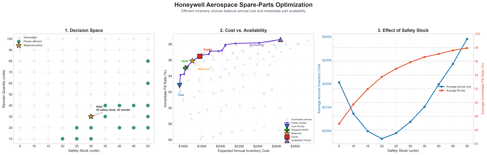

# AI-Driven Spare-Parts Inventory Optimization at Honeywell Aerospace

**Student:** Christelle Jean  
**Instructor:** Professor Alex Shaw  
**Assignment:** Final Project Phase 1 – Build Your Optimization Engine  
**Date:** November 15, 2026  

## Overview

This project builds a multi-objective optimization engine for comparing aerospace spare-parts inventory policies. It tests how safety-stock levels and reorder quantities affect expected annual inventory cost and immediate part availability.

The analysis uses Pareto efficiency to separate strong inventory policies from choices that are more expensive, less available, or both.

## Business Problem

Honeywell Aerospace must keep enough critical spare parts available to avoid maintenance delays and emergency orders. However, keeping too much inventory ties up cash and increases holding, storage, and obsolescence costs.

This project studies the tradeoff between:

- Minimizing expected annual inventory cost
- Maximizing immediate fill rate

## Decision Variables

- **Safety stock:** Extra units held to protect against uncertain demand and lead time
- **Reorder quantity:** Units purchased when inventory reaches its reorder point

## Dataset

The project uses 100 synthetic inventory policies created from:

- 10 safety-stock levels from 5 to 50 units
- 10 reorder quantities from 10 to 100 units
- Every possible combination of these values

The dataset represents one high-criticality aerospace spare part with fixed demand, lead-time, cost, storage, and shortage assumptions. A fixed random seed makes the results reproducible.

The exact generation prompt is available in `data/data_generation_prompt.txt`.

## Optimization Method

The notebook:

1. Generates and validates the synthetic dataset
2. Checks missing values, duplicates, data types, and realistic ranges
3. Calculates Pareto efficiency while minimizing cost and maximizing availability
4. Identifies dominated policies and better efficient alternatives
5. Compares five strategic points on the Pareto frontier
6. Creates professional visualizations of the complete tradeoff space

Cost and availability are normalized to scores from 0 to 100 before balanced, equity, and weighted strategies are calculated. This prevents dollar values from overpowering percentage values.

## Key Findings

- 100 inventory policies were analyzed
- 17 policies are Pareto efficient
- 83 policies are dominated and should be removed from consideration
- Efficient annual costs range from $155,999.75 to $264,149.82
- Efficient fill rates range from 92.81% to 98.59%
- Replacing dominated policy P010 with P041 saves about $117,176 annually while improving fill rate by 6.70 percentage points

## Strategic Policies

| Strategy | Policy | Safety Stock | Reorder Quantity | Annual Cost | Fill Rate |
|---|---:|---:|---:|---:|---:|
| Cost Priority | P031 | 20 | 10 | $155,999.75 | 92.81% |
| Weighted 60/40 | P051 | 30 | 10 | $162,410.40 | 95.02% |
| Balanced | P053 | 30 | 30 | $169,580.61 | 95.90% |
| Equity | P063 | 35 | 30 | $177,703.48 | 96.49% |
| Availability Priority | P098 | 50 | 80 | $264,149.82 | 98.59% |

These strategies represent different business priorities. They are not final recommendations because actual budget, storage, service, and supplier constraints will be added in the next project phase.

## Main Visualization

## Project Structure

- `optimization_engine.ipynb` — Complete data generation and optimization analysis
- `data/data_generation_prompt.txt` — Documented synthetic-data prompt
- `data/synthetic_inventory_policies.csv` — Original 100-policy dataset
- `data/inventory_policies_with_pareto.csv` — Dataset with Pareto classification
- `data/dominated_policy_examples.csv` — Dominated policies and better alternatives
- `data/strategic_policy_comparison.csv` — Five strategic policy choices
- `images/data_exploration.png` — Exploratory visualization
- `images/pareto_frontier_analysis.png` — Three-panel optimization visualization
- `requirements.txt` — Required Python packages

## Technologies
- Python
- Pandas
- NumPy
- Matplotlib
- Jupyter Notebook

## Running the Analysis

1. Clone the repository:

   `git clone https://github.com/ellej180310-glitch/honeywell-spare-parts-optimization.git`

2. Enter the project folder:

   `cd honeywell-spare-parts-optimization`

3. Install the required packages:

   `python -m pip install -r requirements.txt`

4. Open `optimization_engine.ipynb` in Visual Studio Code or Jupyter Notebook.

5. Select a Python 3.12 kernel and run all cells in order.

The notebook recreates the dataset, calculations, tables, CSV outputs, and visualizations.

## Limitations

This project uses synthetic data for one representative part rather than confidential Honeywell records. The model does not yet include repair cycles, multiple warehouses, shelf-life restrictions, supplier disruptions, or changing demand. Results demonstrate the optimization method and would require validation with actual company data before operational use.

## Research Basis

The synthetic data assumptions and optimization approach were informed by company, industry, and academic research:

- Gu, J., Zhang, G., and Li, K. W. (2015). [Efficient aircraft spare parts inventory management under demand uncertainty](https://doi.org/10.1016/j.jairtraman.2014.09.006). *Journal of Air Transport Management, 42*, 101–109.

- Honeywell Aerospace. (2026a, June 3). [Honeywell Aerospace to Host Inaugural Investor Day](https://www.honeywell.com/us/en/news/press-releases/2026/06/honeywell-aerospace-to-host-inaugural-investor-day).

- Honeywell Aerospace. (2026b, October 29). [Logistics Analyst II](https://icfcjb.fa.ocs.oraclecloud.com/hcmUI/CandidateExperience/en/sites/Aerospace/job/127247) [Job posting].

- Honeywell Aerospace. (2026c, July 10). [Honeywell Aerospace Trading: Sourcing Hard-to-Find Parts for 25 Years](https://www.honeywellaerospace.com/us/en/insights/articles/25-years-of-oem-backed-aircraft-parts).

- Honeywell Aerospace. (2026d, September 24). [HONA Investor Horizons: Supply Chain Frequently Asked Investor Questions](https://investor.honeywellaerospace.com/news-releases/news-release-details/hona-investor-horizons-supply-chain-frequently-asked-investor) [Investor update].

- International Air Transport Association and Oliver Wyman. (2025, October). [Reviving the Commercial Aircraft Supply Chain](https://www.iata.org/contentassets/85b59d951fc04c1c83fa2aab47824300/reviving-the-commercial-aircraft-supply-chain.pdf) [Industry report].

- Şahin, M., Eldemir, F., and Turkyilmaz, A. (2021). [Inventory cost minimization of spare parts in aviation industry](https://doi.org/10.1016/j.trpro.2021.11.094). *Transportation Research Procedia, 59*, 29–37.